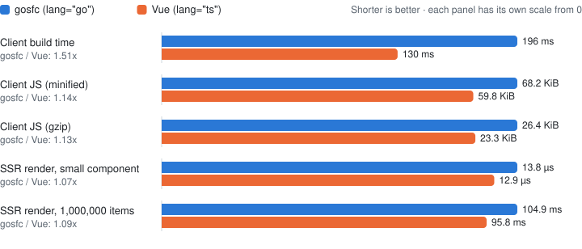

# gosfc

[English](README.md) | 日本語

[](ARCHITECTURE.ja.md)
[](LICENSE)
[](https://go.dev/)
[](https://vuejs.org/)
[](https://vite.dev/)
[](https://astro.build/)
[](https://github.com/goesm-dev/goesm)

Vue Single File Component の `<script setup>` と、`.astro` ファイルのフロントマターと `<script>` で本物の Go を使うための統合レイヤーです。

```vue
<template>
  <div>
    合計: {{ total }}
  </div>
</template>

<script setup lang="go">
import cart "example.com/app/src/features/cart/pkg"

items := []cart.Item{
	{
		Price:    100,
		Quantity: 2,
	},
}

total := cart.Total(items)
</script>
```

`.go` は普通の Go パッケージ、インポートは普通の Go のインポートです。Go のコンパイルは [goesm](https://github.com/goesm-dev/goesm)、SFC とテンプレートは Vue tooling、`.astro` のテンプレートは Astro、ビルドは Vite、ページと SSR は Astro が担当します。設計は [ARCHITECTURE.ja.md](ARCHITECTURE.ja.md) を見てください。

**状態：PoC。** 未実装の項目は ARCHITECTURE.ja.md の「未実装・未決事項」にあります。

## 使い方（Astro）

1. Go モジュールに goesm と gosfc をツールとして追加します。バージョンは go.mod / go.sum で固定されます。gosfc には goesm v0.0.1-beta.3 以降が必要です。

   ```sh
   go get -tool github.com/goesm-dev/goesm/cmd/goesm@<version>
   go get -tool github.com/goesm-dev/gosfc/cmd/gosfc@<version>
   ```

2. Astro にインテグレーションを追加します。プロジェクトに `@astrojs/vue` がインストールされていれば、設定に無い場合に追加されます。Go を `.astro` ファイルだけに書くプロジェクトには、Vue も `@astrojs/vue` も要りません。[examples/astro-go](examples/astro-go) がその例です。

   ```js
   // astro.config.mjs
   import { defineConfig } from "astro/config";
   import gosfc from "@gosfc/astro";

   export default defineConfig({
     integrations: [gosfc()],
   });
   ```

3. `.vue` で `<script setup lang="go">` を使います。

   ```astro
   ---
   import Summary from "../features/cart/Summary.vue";
   ---

   <Summary />
   ```

   `.astro` ファイルも Go で書けます。書き方は「[.astro ファイルで Go を使う](#astro-ファイルで-go-を使う)」で説明します。

Vite だけで使う場合は `@vitejs/plugin-vue` の前に `@gosfc/vite` を置きます。

```js
import vue from "@vitejs/plugin-vue";
import gosfc from "@gosfc/vite";

export default { plugins: [gosfc(), vue()] };
```

`lang="ts"` や素の `<script setup>` のコンポーネントはそのまま共存できます。gosfc が触るのは `lang="go"` のコンポーネントだけです。

## Go ブロックの書き方

* トップレベルは Vue の `<script setup>` と同じくコンポーネントインスタンスごとに上から 1 回実行されます。`x := ...`、`var`、`const`、`type`、`func F() {...}` が書けます。
* トップレベルの変数・定数・関数はテンプレートから参照できます。Go 関数をテンプレートから呼ぶ（`@click="Increment"` など）と、表示が Go の値に追従します。値や、呼び出しの引数と戻り値は goesm の[エクスポートされた関数](https://github.com/goesm-dev/goesm/blob/main/docs/js-exports.ja.md)と同じく変換されます。文字列は文字列、スライスは配列、struct は普通のオブジェクトになります。メソッドを持つ struct 型へのポインタは、goesm が Go のオブジェクトのまま JavaScript に渡しますが、テンプレートには `js` タグか `json` タグの名前でフィールドを読める普通のオブジェクト（`{{ Get().x }}`）として見え、メソッドも呼べます（`@click="acct.Deposit(5)"`）。それを Go の関数に渡すと、元の Go のオブジェクトに戻ります。
* setup と、描画中にテンプレートが呼ぶ Go 関数（`{{ Total() }}`、`:title="Name()"`、`v-if="Ready()"`）はブロックしてはいけません。Vue はどちらも待てません。そこで待つブロック（`time.Sleep`、チャネル、ミューテックス、インポートした Promise、またはそれらを呼ぶ関数の呼び出し）は、ブロックする呼び出しの連なりを示すコンパイルエラーになります。ブロックする処理は goroutine で実行し、結果を `vue.Ref` に入れてください。イベントハンドラーはブロックしてもかまいません。
* `import` で取り込めるのは Go のパッケージだけです。`.astro` ファイルの Go のフロントマターでは、後述のとおり JavaScript のモジュールも import できます。Vue コンポーネントの Go ブロックには、Vue コンポーネント、TypeScript、JavaScript を goesm の [`//goesm:import`](https://github.com/goesm-dev/goesm/blob/main/docs/js-imports.ja.md) ディレクティブで取り込みます。コンポーネントやクラスなどの値は `var` の前に、関数は本体のない関数宣言の前にディレクティブを書きます。関数の引数と戻り値は自動で変換されます。どちらもブロックのほかの名前と同じくテンプレートから使えます。これらはパッケージレベルで宣言されるので、型にはインポートした型、組み込みの型、ブロックで宣言した型を使えます。

  ```vue
  <template>
    <p>{{ formatPrice(12800) }} <Badge label="新着" /></p>
  </template>

  <script setup lang="go">
  import "syscall/js"

  //goesm:import "./Badge.vue"
  var Badge js.Value

  //goesm:import "./format.ts" formatPrice
  func formatPrice(yen int) string
  </script>
  ```
* `type` と `const` の宣言、メソッド（`func (t Tag) Label() string`）は、ブロックのパッケージのパッケージレベルで宣言されます。`Props` やメソッドはブロックの型を使えます。メソッドから見えるのはパッケージの名前（インポート、型、定数）で、setup の変数は見えません。ジェネリック関数は Go パッケージに置いてください。
* props を受け取るには `type Props struct {...}` を宣言します。ブロックの中でその型の `props` 変数が使えます。フィールド `Route` は属性 `route`（`js` タグか `json` タグがあればその名前、または kebab-case の形）から読み、フィールドの型に変換します。文字列、bool、数値のほか、struct、スライス、ポインタ（`null` は nil）、関数も goesm の ABI のとおりに変換します。フィールドの `default:"..."` タグは、親が渡さなかった props の値になります。フィールドは型付きの Vue の props として宣言されます。`bool` のフィールドは `Boolean` の prop（`<Dialog open />` は true、属性がなければ false）で、`default` タグのあるフィールドはその値が標準値になります。テンプレートや `$props` から読んでも同じです。親が新しい props を渡すと `props` が置き換わり、テンプレート（`{{ props.Title }}`）も読み直します。フィールドは Vue の props として宣言されるので、ほかの属性（`class`、`style`、リスナー）は普通どおりルート要素にフォールスルーします。

  ```vue
  <script setup lang="go">
  import "strings"

  type Props struct {
  	Title string
  }

  heading := strings.ToUpper(props.Title)
  </script>
  ```

## リアクティビティ: vue パッケージ

Vue は Go の変数を見られません。テンプレートが値を読み直すのは、テンプレート自身が Go を呼んだ後（イベントハンドラ）だけです。ひとりでに変わる状態（タイマー、ゴルーチン、別のコンポーネント）は、パッケージ `github.com/goesm-dev/gosfc/vue` の `vue.Ref` に入れます。

```vue
<template>
  <p>{{ seconds }} 秒（{{ Label() }}）</p>
  <input v-model="name" />
  <canvas ref="canvas"></canvas>
</template>

<script setup lang="go">
import (
	"syscall/js"
	"time"

	"github.com/goesm-dev/gosfc/vue"
)

seconds := vue.NewRef(0)
name := vue.NewRef("")
canvas := vue.NewRef(js.Null())
emit := vue.Emitter()

func Label() string { return "こんにちは " + name.Get() }

vue.OnMounted(func() {
	go func() {
		for range time.Tick(time.Second) {
			seconds.Set(seconds.Get() + 1)
		}
	}()
})
vue.Watch(func() int { return seconds.Get() }, func(n int) { emit("tick", n) })
</script>
```

* テンプレートにバインドした Ref は値として読め、どこで `Set` されても（別のパッケージからでも）追従します。Ref を Go パッケージに置いて、複数のコンポーネントで共有できます。すべてのコンポーネントの Go（と JavaScript が `go:` でインポートするパッケージ）は、Go のバイナリのパッケージと同じく 1 つの goesm プログラムなので、パッケージの変数はアプリ全体で 1 組です。ただし、別々に動くブラウザとサーバーで 1 組ずつです。ブラウザのプログラムには、サーバーだけで動く Go（`.astro` の Go のフロントマター、TypeScript のフロントマターの `go:` インポート、`@gosfc/astro` ではエンドポイント・ミドルウェア・アクションの `go:` インポート）を入れません。そのため、その Go が使うものでブラウザのバンドルが大きくなりません。`v-model` と `ref="..."` は `Set` で書き込みます。関数 ref（`:ref="(el) => SetEl(el)"`）から Go を呼べます。Vue はページのパッチ中にそれを呼ぶので、その呼び出しではコンポーネントを再レンダーしません。テンプレートに出すものは `vue.Ref` に入れてください。
* テンプレートから呼んだ Go 関数は、その中で読んだ Ref が変わると再実行されます。
* `vue.NewComputed` はキャッシュされる派生値を作ります。`vue.Watch` と `vue.WatchEffect` は副作用を実行し、コンポーネントの props が変わったときにも再実行されます。
* `vue.OnMounted`、`OnBeforeUnmount`、`OnUnmounted` と `vue.Emitter` は setup 中のコンポーネントに結び付くので、ブロックのトップレベルで呼びます。`ModelValue` の props と `emit("update:modelValue", v)` で、コンポーネントが `v-model` に対応します。
* goesm のビルド以外（`go test`）では、Ref と Computed は値を保持・計算し、ウォッチャーとフックは実行されません。
* gosfc には goesm v0.0.1-beta.6 以降が必要です。`any` に入ったハンドルがメソッドを持ち、複数のパッケージを 1 つのプログラムとしてビルドでき、アプリのほかの関数値がブロックしても、コンポーネントの関数変数 (`update := func() {...}`) で setup が async にならない版です。

## .astro ファイルで Go を使う

フロントマターを `---` ではなく `---go` で始めると、その中身は Go になります。規則は `.vue` の Go ブロックと同じです。トップレベルはレンダリングごとに 1 回実行されます。静的ビルドではビルド時、SSR ではリクエストごとの実行です。トップレベルの変数・定数・関数はテンプレートから参照できます。

```astro
---go
import (
	"strconv"

	cart "example.com/app/src/features/cart/pkg"
	Line "../features/cart/Line.astro"
	Summary "../features/cart/Summary.vue"
)

items := []cart.Item{
	{Price: 120, Quantity: 3},
	{Price: 80, Quantity: 1},
}
total := cart.Total(items)

func Yen(n int) string {
	return "¥" + strconv.Itoa(n)
}
---

<Line label="りんご" price={120} quantity={3} />
<p>合計: {Yen(total)}、{items.length} 品目</p>
<Summary />
```

* コンポーネントやスタイル、npm パッケージなどの JavaScript のモジュールは Go のインポート構文でインポートします。`import Card "./Card.vue"` は `import Card from "./Card.vue"` と同じ意味になり、`import _ "./global.css"` は副作用のためのインポートになります。インポートパスが `./`、`../`、`/`、`@` で始まるか `:` を含む場合は JavaScript のモジュールとして扱います。`astro:assets` も JavaScript のモジュールです。それ以外のパスは Go のパッケージです。
* `type Props struct {...}` を宣言すると `Astro.props` を受け取れます。フィールド名と props の名前の対応は `.vue` の Go ブロックと同じで、フィールド `Label` は `label` から読みます。
* テンプレートに渡る値は JavaScript 向けに変換されます。文字列は JavaScript の文字列、スライスは配列、struct はオブジェクトになります。テンプレートから Go の関数を呼ぶこともできます。
* チャネルや `time.Sleep` などで Go のコードがブロックする場合、フロントマターはその完了を待ちます。

テンプレートの中の `<script lang="go">` は、ブラウザでページごとに 1 回実行される Go です。Astro が処理する通常の `<script>` と同じように Astro がバンドルし、コンポーネントを何度使ってもページに含まれるのは 1 回だけです。トップレベルの名前はテンプレートから参照できません。DOM の操作には `syscall/js` を使います。

```astro
<button id="counter">0</button>

<script lang="go">
import (
	"strconv"
	"syscall/js"
)

count := 0
button := js.Global().Get("document").Call("getElementById", "counter")
button.Call("addEventListener", "click", js.FuncOf(func(this js.Value, args []js.Value) any {
	count++
	button.Set("textContent", strconv.Itoa(count))
	return nil
}))
</script>
```

制限は次のとおりです。

* Go のフロントマターは何もエクスポートできません。`getStaticPaths` などのエクスポートには TypeScript のフロントマターが必要です。TypeScript のフロントマターからも、次の節で説明する `go:` specifier で Go をインポートできます。
* Go のコードから使える `Astro` グローバルの情報は props だけです。`Astro.url`、`Astro.cookies`、リダイレクトなどを使うには TypeScript のフロントマターを書きます。
* Go のインポート構文で書けるのは default インポートと副作用のためのインポートだけです。JavaScript のモジュールの名前付きエクスポートを使うには、それを default エクスポートとして再エクスポートする小さなモジュールを作り、そのモジュールをインポートします。
* `<script lang="go">` には他の属性を付けられません。`is:inline` や `define:vars` も使えません。

## JavaScript から Go をインポートする

Go モジュールの中にある `.js`、`.ts`、`.astro` のモジュールは、`go:` specifier で Go パッケージを直接インポートできます。gosfc はインポートした側のファイルが属する Go モジュールで goesm を使ってそのパッケージをコンパイルし、Vite が他のモジュールと同じようにバンドルします。API は goesm の [JS 呼び出し ABI](https://github.com/goesm-dev/goesm/blob/main/docs/js-exports.ja.md) に従います。エクスポートされた関数は、文字列、配列、オブジェクトといった普通の JavaScript の値を受け取り、返します。

```astro
---
// src/pages/[slug].astro
import { Slugs } from "go:example.com/app/content";

export function getStaticPaths() {
  return Slugs().map((slug) => ({ params: { slug } }));
}
---
```

これらの import には TypeScript の型が付きます。goesm v0.0.1-beta.8 以降では、goesm がエクスポートの宣言ファイルを書き出します (`goesm emit-ts -dts`)。gosfc はそれをもとに、JavaScript が `go:` で import する各パッケージをモジュールとして宣言します。

```ts
declare module "go:example.com/app/content" {
  export function Slugs(): Array<string>;
}
```

Astro では、`@gosfc/astro` がこの宣言を `.astro/integrations/_gosfc_astro/go-imports.d.ts` に書き出します。このファイルは `.astro/types.d.ts` から参照されるので、`astro check` とエディターから型が見えます。`astro sync` と、それを実行する `astro check` は、Go をコンパイルして宣言を書き出します。`astro dev` と `astro build` は、コンパイルするたびに宣言を書き直します。Vite だけを使う場合、`@gosfc/vite` は Vite のルートの `gosfc.d.ts` に宣言を書き出します。このファイルは、プロジェクトの `tsconfig.json` の `include` に含めます。`gosfc({ dts: "src/gosfc.d.ts" })` で別のファイルを指定でき、`gosfc({ dts: false })` で書き出さないようにできます。Go を一度もコンパイルしていない間は、すべての `go:` の import を `any` として宣言します。

このファイルは、各 `.vue` ファイルの Go ブロックのパッケージも宣言します。Vue の言語プラグインは、ここからコンポーネントの props の型を読みます（次の節）。

## vue-tsc で型チェックする

vue-tsc と Vue のエディター拡張は、TypeScript か JavaScript の `<script setup>` からだけ TypeScript を生成します。Go のコンポーネントからは何も生成しないので、それを import する TypeScript のコンポーネントは `TS2306: File '.../Rating.vue' is not a module` で失敗します。`@gosfc/vite` には、Go ブロックごとに TypeScript での見え方を Vue の言語ツールに渡すプラグインがあります。`tsconfig.json` で指定します。

```jsonc
{
  "vueCompilerOptions": {
    "plugins": ["@gosfc/vite/vue-language-plugin"] // Astro では "@gosfc/astro/vue-language-plugin"
  }
}
```

これで Go のコンポーネントは TypeScript からもコンポーネントとして見えます。末端のコンポーネントから Go に移し、それを使う TypeScript のコンポーネントはそのまま残せます。

```vue
<!-- Rating.vue -->
<template>
  <button @click="Rate">{{ props.Label }}</button>
</template>

<script setup lang="go">
import "github.com/goesm-dev/gosfc/vue"

type Props struct {
	Label string
	Max   int `default:"5"`
}

emit := vue.Emitter()

func Rate() {
	emit("rated", props.Max)
}
</script>
```

```vue
<!-- Review.vue -->
<template>
  <Rating label="品質" :max="3" @rated="onRated" />
</template>

<script setup lang="ts">
import Rating from "./Rating.vue";

function onRated(stars: number) {
  console.log(stars);
}
</script>
```

* props は `type Props struct` のフィールドで、コンポーネントが宣言する名前（`label`、`max`、`json:"note-text"` タグのフィールドなら `noteText`）になります。フィールドに `default` タグがある、`js` か `json` タグに `omitempty` がある、または型が nil を持つ（ポインタ、スライス、マップ、関数、インターフェース：`null`）か `bool` なら、その prop は省略できます。ほかの props は必須です（`label` のない `<Rating max="3" />` は `error TS2345` になります）。型は goesm がフィールドに付ける型です（`<Rating :max="'three'" />` は `error TS2322: Type 'string' is not assignable to type 'number'` になります）。前の節の型ファイルから読むので、そのファイルを TypeScript のプロジェクトに含めてください。Go を一度コンパイルする（開発サーバー、ビルド、`astro sync`、`astro check`）までは、props は `any` です。
* イベントは、`vue.Emitter()` が返す関数にブロックが文字列リテラルで渡す名前で、引数は `any` です。
* Go のコンポーネントのテンプレートは、Go ブロックのバインディングを `any` 型として読みます。ブロックが宣言していない名前はエラーになります。

プラグインは Vite プラグインと同じく `go tool gosfc synth` で Go ブロックを読みます。Go はコンパイルしません。go コマンドか gosfc ツールがないときは、一度だけ警告を出し、Go のコンポーネントの props とバインディングを `any` にします。この見え方は `.vue` ファイルのどこにも対応付けないので、エラー、ホバー、フォーマットが Go のコードに及ぶことはありません（Go のエディター支援は gopls の役割です。ARCHITECTURE.ja.md §12 を参照）。

`astro check` は `.vue` ファイルを vue-tsc に任せます。Go のコンポーネント（`.vue` でも `.astro` でも）を import する `.astro` ファイルは普通どおりチェックされ、Astro は Go の `.vue` コンポーネントの props を `Record<string, any>` とします。Go のフロントマターは TypeScript として読むので、Go を書いた `.astro` ファイルは `tsconfig.json` の `include` から外してください（`exclude`）。それらを import するファイルはチェックされます。[examples/astro](examples/astro) はこの形で `astro check && vue-tsc --noEmit` を実行します（`pnpm check`）。

`@gosfc/vite` と `@gosfc/astro` は型宣言を含むので、それらを import する `vite.config.ts` や `astro.config.mjs` のオプションも型チェックされます。

制限:

* ほかの関数やパッケージを通して emit するイベントや、名前が文字列リテラルでないイベントは宣言されません。宣言されていないイベントを vue-tsc が報告するのは `checkUnknownEvents` のときだけです。
* Props に埋め込んだ struct のフィールドは props として宣言されません。実行時も Vue の props ではなく、属性から読みます。

## ベンチマーク

同じコンポーネントを `<script setup lang="go">` と `<script setup lang="ts">` で書いて比べています（[bench/](bench)）。どちらも Vite 8 と `@vitejs/plugin-vue` でビルドし、Go 側は前に `@gosfc/vite` を置く以外は同じ設定です。

<picture>
  <source media="(prefers-color-scheme: dark)" srcset="bench/results-dark.svg">
  
</picture>

| | gosfc (`lang="go"`) | Vue (`lang="ts"`) | ratio |
|---|---:|---:|---:|
| Client build time | 196 ms | 130 ms | 1.51x |
| Client JS (minified) | 68.2 KiB | 59.8 KiB | 1.14x |
| Client JS (gzip) | 26.4 KiB | 23.3 KiB | 1.13x |
| SSR render, small component | 13.8 µs | 12.9 µs | 1.07x |
| SSR render, 1,000,000 items | 104.9 ms | 95.8 ms | 1.09x |

* **Client build time**：カウンターとカートのサマリーを置いたページの `vite build`。それぞれウォームアップのビルドを 1 回してから、先にビルドする側を入れ替えながら 9 回測った中央値です。goesm のバイナリと go コマンドのビルドキャッシュは温まった状態で、編集してビルドし直すときと同じ条件です。
* **Client JS**：そのビルドの JS ファイルすべて（Vue のランタイムを含む）。差（+8.4 KiB、gzip で +3.1 KiB）は goesm のランタイムと Go の意味論を守るためのコードです。
* **SSR render**：プロダクションの SSR ビルドで `renderToString` した時間で、両者は同じ HTML を出力します。それぞれの側とコンポーネントごとに新しい Node プロセスで、順番を入れ替えながら 5 回測った中央値です。「small component」は 3 品のカートのサマリー、「1,000,000 items」はコンポーネントの setup で 1,000,000 品を作って合計するもので、どちらも時間の大半はメモリ確保です。そこでの小さな差は、goesm が Go の意味論を守るために生成するコード（たとえば `range` での struct の値コピー）によるものと思われますが、プロファイルはまだ取っていません。

2026-10-04 に `pnpm bench` で測りました。`mise.toml` のバージョン（Node.js 26.10.0、Go 1.27.1）と goesm 20dbf1d を使い、4 vCPU の Intel Xeon 2.80GHz のクラウド VM で実行しています。サイズは決定的ですが、時間はこの環境では実行ごとに揺れます（6 回の実行で、比はビルドが 1.51x〜1.73x、small component が 1.02x〜1.26x、1,000,000 items が 1.09x〜1.20x でした）。

## 開発

Go、Node.js、pnpm は [mise](https://mise.jdx.dev/) で `mise.toml` のバージョンに揃えます。

```sh
mise install
pnpm install
pnpm test                      # go test ./... と tests/*.test.mjs
pnpm bench                     # bench/run.mjs：ベンチマークの表を出力し、bench/results-*.svg を書き直す
cd examples/astro && pnpm build   # dist/index.html に「合計: 200」、dist/go/index.html は src/pages/go.astro
cd examples/astro && pnpm dev
```

ブラウザでの HMR テストは `/opt/pw-browsers/chromium`（または `CHROMIUM` 環境変数）の Chromium を使い、無ければスキップします。

## コントリビューション / ライセンス

コントリビューションの方法と設計原則は [CONTRIBUTING.ja.md](CONTRIBUTING.ja.md) を見てください。gosfc は [MIT License](LICENSE) で公開されています。
